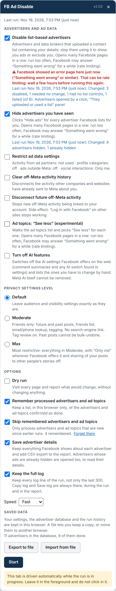

# fb-ad-disable

A script for Google Chrome that works through Facebook's own settings pages for you, while you are logged in, to:

- stop advertisers and data brokers that uploaded a contact list containing your details from using it to target you,
- hide the advertisers Facebook lists for you,
- switch off the ad settings that let Meta use partner data, your profile categories and your activity off Meta,
- clear (and optionally disconnect) your off-Meta activity,
- tighten your audience and visibility settings to a level you choose: **Default**, **Moderate** or **Max**.

You pick what to run from a menu, press **Start**, and get a report at the end.



The script only clicks controls on facebook.com, the same ones you would click by hand. It has no server, collects nothing and sends nothing anywhere.

## Before you start

- **Read this first: Facebook changes its pages often.** The script finds controls by their visible English text. When it cannot complete a step it does not guess: the step is listed in the final report as "Needs manual check", with a link to the page and the value to set. Expect a few of those.
- **Set Facebook's language to English (US)** for the run (Settings → Language and region). Only the advertiser-list task also has Portuguese labels.
- **Do a dry run first.** Tick *Dry run* in the menu: the script visits every page and reports what it would change, without changing anything.
- Use a desktop Chrome window, leave the Facebook tab in the foreground while it works, and do not click in it.
- Two actions cannot be undone in one click: **Limit past posts** (part of Moderate and Max) and **Clear off-Meta activity history**. Facebook may also ask for your password before some changes; the script cannot enter it, so those steps end up in the manual list.

## How to use it

There are three ways to run the same file, `fb-ad-disable.js`. The extension is the most convenient because a full run moves between `www.facebook.com` and `accountscenter.facebook.com`, and only the extension and the userscript survive those page loads without your help.

### Option 1: Chrome extension (recommended)

1. Download this repository (**Code → Download ZIP**, then unzip) or clone it.
2. In Chrome open `chrome://extensions`.
3. Turn on **Developer mode** (top right).
4. Click **Load unpacked** and select the `fb-ad-disable` folder (the one containing `manifest.json`).
5. Pin the extension (puzzle-piece icon → pin) so its icon is visible.
6. Open [facebook.com](https://www.facebook.com) and make sure you are logged in.
7. Click the **FB Ad Disable** toolbar icon. The menu appears at the top right of the page.
8. Choose your tasks and privacy level (see below), tick **Dry run** the first time, and press **Start**.
9. Wait for the report. The tab moves between pages by itself; a full run takes a few minutes, longer if you have many advertisers.

The extension only runs on Facebook pages and does nothing until you click its icon. Remove it or switch it off in `chrome://extensions` when you are done.

### Option 2: Userscript (Tampermonkey or Violentmonkey)

1. Install [Tampermonkey](https://www.tampermonkey.net/) in Chrome.
2. Tampermonkey icon → **Create a new script**, delete the template, paste the whole content of `fb-ad-disable.js`, and save.
3. Open [facebook.com](https://www.facebook.com), logged in.
4. Tampermonkey icon → **Open FB Ad Disable**.
5. Choose your options and press **Start**, as above.

### Option 3: Paste into the DevTools console (nothing to install)

1. Open [facebook.com](https://www.facebook.com), logged in.
2. Press `F12` (or `Ctrl+Shift+J`, on a Mac `Cmd+Option+J`) and select the **Console** tab.
3. Chrome blocks pasting into the console the first time: type `allow pasting` and press Enter. Facebook also prints a warning there about pasting code you do not understand. That warning is sound advice in general; read `fb-ad-disable.js` before you paste it.
4. Paste the whole content of `fb-ad-disable.js` and press Enter. The menu appears.
5. Choose your options and press **Start**.
6. **When the page reloads, the menu disappears**, because a pasted script cannot survive a page load. Press `↑` then Enter in the console (or paste again) and the run continues from where it stopped. Repeat until the report appears.

To avoid re-pasting, save the script once under **Sources → Snippets → New snippet** and run it with `Ctrl+Enter`.

Console mode is fine for a single task such as *Disable list-based advertisers*, which stays on one page. For a full run, use the extension.

### The menu

| Section | What to choose |
| --- | --- |
| **Advertisers and ad data** | Tick the tasks to run (table below). |
| **Privacy settings level** | Default, Moderate or Max (table below). |
| **Dry run** | Report what would change without changing anything. |
| **Speed** | Pause between clicks. Use *Slow* if steps fail on a slow connection. |

While it runs, the panel shows the current step and a log. **Stop** ends the run after the current click. If a run is interrupted, opening the menu again offers **Resume it**.

### The report

Each step ends in one of these states:

| | Meaning |
| --- | --- |
| ✅ Changed | The script clicked the control. Spot-check a few of these. |
| ☑️ Already set | The setting already had the wanted value. |
| 👁 Dry run | What would be changed. |
| ⚠️ Needs manual check | The script could not do it. Use the **Open page** link and set the value shown. |

**Copy report** puts the report on the clipboard. If something fails on your account, the report plus the log lines in the panel are what is needed to fix the labels.

## What each task does

| Task | Where | What happens |
| --- | --- | --- |
| **Disable list-based advertisers** | Accounts Center → Ad preferences → Audience-based advertising | For every advertiser: open it → *They uploaded or used a list to reach you* → **Don't allow**, for both showing you ads and excluding you from ads. This is the original script this project grew from. |
| **Hide advertisers you have seen** | Ad preferences → Advertisers | Clicks **Hide ads** for each advertiser. |
| **Restrict ad data settings** | Ad preferences → Manage info | *Activity information from ad partners* → "No, don't make my ads more relevant…" · *Categories used to reach you* → all off · *Ads shown outside of Meta* → not allowed · *Social interactions* → Only me. |
| **Clear off-Meta activity history** | Your activity off Meta technologies | **Clear previous activity**. |
| **Disconnect future off-Meta activity** (off by default; Max ticks it) | same page | *Manage future activity* → **Disconnect future activity**. Side effect: "Log in with Facebook" on other sites and apps stops working. |
| **Ad topics: See less** (experimental, off by default) | Ad preferences → Ad topics | Opens each topic and picks **See less**. |

## Privacy levels

**Default** changes none of these. Moderate and Max set:

| Setting | Moderate | Max |
| --- | --- | --- |
| Who can see your future posts | Friends | Only me |
| Limit who can see past posts | Limited to Friends | Limited to Friends |
| Who can send you friend requests | Friends of friends | Friends of friends |
| Who can see your friends list | Friends | Only me |
| Who can look you up by email address | Friends | Only me |
| Who can look you up by phone number | Friends | Only me |
| Search engines outside Facebook link to your profile | Off | Off |
| Who can follow you | Friends | Friends |
| Who can see the people, Pages and lists you follow | Friends | Only me |
| Who can comment on your public posts | Friends | Friends |
| Who can like or comment on public profile info | Friends | Friends |
| Who can post on your profile | Friends | Only me |
| Who can see what others post on your profile | Friends | Only me |
| Who can see posts you are tagged in on your profile | Friends | Only me |
| Review posts you are tagged in before they appear | On | On |
| Review tags people add to your posts | On | On |
| Allow others to share your posts to their stories | unchanged | Off |

Where Facebook offers nothing stricter than Friends (followers, public comments), Max uses Friends.

## What this cannot do

- **It cannot delete what data brokers hold.** It stops brokers and advertisers from using their lists and your off-Meta activity to target you on Meta, which is the part Facebook lets you control. To have a broker delete your record you must ask the broker (or use an opt-out service or your regional privacy rights, for example GDPR or CCPA requests).
- It does not change the visibility of individual profile fields (birthday, phone, email, hometown, relationship). Review those under your profile → About.
- It does not touch Messenger active status, location settings in the mobile apps, or apps and websites connected to your account (Settings → Apps and websites). Do those by hand.
- New advertisers appear over time. Run the advertiser tasks again every few months.

## How well tested is it

- The engine (menu, page navigation and resume, text matching, dry run, reporting, the three run modes) is covered by automated tests that drive the real script in Chromium against mock Facebook pages: `npm test`.
- The advertiser-list flow keeps the click sequence of the original console script this project started from.
- No flow has been verified end to end on a live account by the automated tests: they cannot log in to Facebook. The setting names come from Facebook's documented labels. That is why every step is reported and why you should start with a dry run.

A safety rule that is tested: an option such as "Friends" or "Only me" is only ever clicked inside a dialog, menu or radio group, never elsewhere on the page.

## Troubleshooting

- **Many steps say "Needs manual check".** Check Facebook is in English (US), try *Slow* speed, and run again; finished steps are quick the second time because they report "Already set".
- **The panel vanished (console mode).** The page reloaded. Run the script again and it resumes.
- **A label changed.** Labels live in three tables at the top of `fb-ad-disable.js`: `L` (shared buttons), `AD_SETTINGS` and `PRIVACY`. Each `row` entry is a list of lower-case text fragments; add the new wording next to the old one.
- **Another language.** Add a key next to `en` in `L`, and add the translated row text to the `row` lists.
- **`web.facebook.com`.** Supported: start the script there.

## Development

```bash
npm install
```

```bash
npm test
```

| File | Purpose |
| --- | --- |
| `fb-ad-disable.js` | The script: userscript header, settings tables, engine, panel. |
| `manifest.json`, `background.js` | Chrome extension wrapper (toolbar icon opens the menu). |
| `test/mock/` | Mock Facebook pages. |
| `LICENSE` | MIT licence. |
| `test/run.test.js` | End-to-end tests (Playwright). |

## Disclaimer

This is an unofficial tool, not affiliated with or endorsed by Meta. It automates your own account's settings pages; use it at your own discretion and check the result.

## License

[MIT](LICENSE) © 2026 Privaterra
