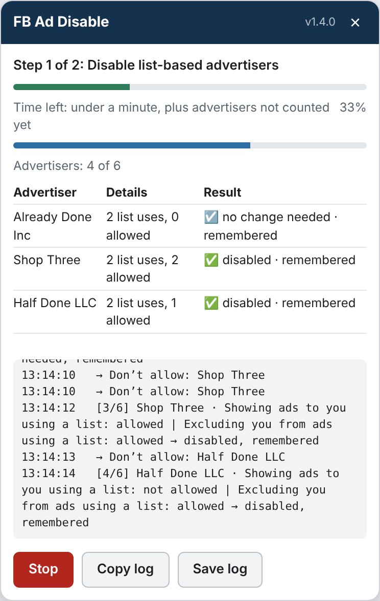

# fb-ad-disable

A script for Google Chrome that works through Facebook's own settings pages for you, while you are logged in, to:

- stop advertisers and data brokers that uploaded a contact list containing your details from using it to target you,
- hide the advertisers Facebook lists for you,
- switch off the ad settings that let Meta use partner data, your profile categories and your activity off Meta,
- clear (and optionally disconnect) your off-Meta activity,
- switch off the AI features Facebook lets you switch off,
- tighten your audience and visibility settings to a level you choose: **Default**, **Moderate** or **Max**.

You pick what to run from a menu, press **Start**, and get a report at the end.


The script only clicks controls on facebook.com, the same ones you would click by hand. It has no server, collects nothing and sends nothing anywhere.

## Before you start

- **Read this first: Facebook changes its pages often.** The script finds controls by their visible English text. When it cannot complete a step it does not guess: the step is listed in the final report as "Needs manual check", with a link to the page and the value to set. Expect a few of those.
- **Set Facebook's language to English (US)** for the run (Settings → Language and region). Only the advertiser-list task also has Portuguese labels.
- **Do a dry run first.** Tick *Dry run* in the menu: the script visits every page and reports what it would change, without changing anything.
- Use a desktop Chrome window, leave the Facebook tab in the foreground while it works, and do not click in it.
- Two actions cannot be undone in one click: **Limit past posts** (part of Moderate and Max) and **Clear off-Meta activity history**. Facebook may also ask for your password before some changes; the script cannot enter it, so those steps end up in the manual list.

## How to use it

There are three ways to run the same file, `fb-ad-disable.js`. The extension is the most convenient because a full run moves between `www.facebook.com` and `accountscenter.facebook.com`, and only the extension and the userscript survive those page loads without your help.

### Option 1: Chrome extension (recommended)

1. Download this repository (**Code → Download ZIP**, then unzip) or clone it.
2. In Chrome open `chrome://extensions`.
3. Turn on **Developer mode** (top right).
4. Click **Load unpacked** and select the `fb-ad-disable` folder (the one containing `manifest.json`).
5. Pin the extension (puzzle-piece icon → pin) so its icon is visible.
6. Open [facebook.com](https://www.facebook.com) and make sure you are logged in.
7. Click the **FB Ad Disable** toolbar icon. The menu appears at the top right of the page.
8. Choose your tasks and privacy level (see below), tick **Dry run** the first time, and press **Start**.
9. Wait for the report. The tab moves between pages by itself; a full run takes a few minutes, longer if you have many advertisers.

The extension only runs on Facebook pages and does nothing until you click its icon. Remove it or switch it off in `chrome://extensions` when you are done.

### Option 2: Userscript (Tampermonkey or Violentmonkey)

1. Install [Tampermonkey](https://www.tampermonkey.net/) in Chrome.
2. Tampermonkey icon → **Create a new script**, delete the template, paste the whole content of `fb-ad-disable.js`, and save.
3. Open [facebook.com](https://www.facebook.com), logged in.
4. Tampermonkey icon → **Open FB Ad Disable**.
5. Choose your options and press **Start**, as above.

### Option 3: Paste into the DevTools console (nothing to install)

1. Open [facebook.com](https://www.facebook.com), logged in.
2. Press `F12` (or `Ctrl+Shift+J`, on a Mac `Cmd+Option+J`) and select the **Console** tab.
3. Chrome blocks pasting into the console the first time: type `allow pasting` and press Enter. Facebook also prints a warning there about pasting code you do not understand. That warning is sound advice in general; read `fb-ad-disable.js` before you paste it.
4. Paste the whole content of `fb-ad-disable.js` and press Enter. The menu appears.
5. Choose your options and press **Start**.
6. **When the page reloads, the menu disappears**, because a pasted script cannot survive a page load. Press `↑` then Enter in the console (or paste again) and the run continues from where it stopped. Repeat until the report appears.

To avoid re-pasting, save the script once under **Sources → Snippets → New snippet** and run it with `Ctrl+Enter`.

Console mode is fine for a single task such as *Disable list-based advertisers*, which stays on one page. For a full run, use the extension.

### The menu

| Section | What to choose |
| --- | --- |
| **Advertisers and ad data** | Tick the tasks to run (table below). |
| **Privacy settings level** | Default, Moderate or Max (table below). |
| **Dry run** | Report what would change without changing anything. |
| **Remember processed advertisers** (on) | Keep a list of the list-based advertisers confirmed as disabled, for later runs. |
| **Skip remembered advertisers** (on) | Only process advertisers that are new since earlier runs. The menu shows how many are remembered, with **Forget them** to clear the list. |
| **Save advertiser details** (off) | Build a table of every advertiser processed, to export as CSV from the report. |
| **Save logs** (off) | Keep the full log and add **Copy log** and **Save log** buttons. |
| **Speed** | Pause between clicks. Use *Slow* if steps fail on a slow connection. |

### While it runs



- The **top bar** is overall progress: the step number, the percentage done and the estimated time left.
- A **second bar** appears while advertisers are being processed. The script first opens the whole advertiser list to count it, then fills the bar as it works through them. When the advertisers are done the bar disappears.
- **Time left** is estimated from how fast the run is actually going: the average time per step so far, and the average time per advertiser. It is rough at the start and improves as the run proceeds. Until an advertiser list has been counted, the estimate says "plus advertisers not counted yet".
- **Stop** ends the run after the current click. If a run is interrupted, opening the menu again offers **Resume it**.

### The report

Each step ends in one of these states:

| | Meaning |
| --- | --- |
| ✅ Changed | The script clicked the control. Spot-check a few of these. |
| ☑️ Already set | The setting already had the wanted value. |
| 👁 Dry run | What would be changed. |
| ⚠️ Needs manual check | The script could not do it. Use the **Open page** link and set the value shown. |
| ℹ️ Nothing to do | The page has nothing for this step: no AI switches, or a setting Facebook no longer offers on your account. |

When a step fails, the report keeps **What the page showed**: the text and controls that were on screen at that moment, with email addresses and long numbers removed. That is what makes a wrong label fixable, so include it when you report a problem (**Copy report** contains it). It is your own settings page, so read it before sharing.

**Copy report** puts the report on the clipboard. If something fails on your account, the report plus the log are what is needed to fix the labels.


### Remembered advertisers

With **Remember processed advertisers** on, each list-based advertiser is added to a list once the page itself confirms it is disabled (an "Allow" button is shown and no "Don't allow" button is left). With **Skip remembered advertisers** on, later runs leave those advertisers alone and only open the new ones, which makes repeat runs much shorter.

- The list is kept in this browser only: in the extension's or userscript manager's storage, or in the site's local storage in console mode. It is never sent anywhere.
- An advertiser the script could not confirm (a failure, or no list-use buttons found) is not remembered, so it is checked again next time.
- A dry run does not add to the list.
- Untick **Skip remembered advertisers** to re-check everyone, or use **Forget them** in the menu to clear the list.
- Only the list-based advertiser task uses this. Advertisers whose ads are already hidden are skipped by Facebook's own page (their button no longer says "Hide ads").

### Advertiser details (CSV)

With **Save advertiser details** on, the report shows a table of every advertiser processed, with **Export CSV** (saves a file) and **Copy CSV**. The file has one row per advertiser and these columns:

| Column | Content |
| --- | --- |
| `task` | `list-based` or `seen` |
| `name` | Advertiser name as shown in the list |
| `advertiser_id` | The id in the advertiser's link, when there is one |
| `result` | `disabled`, `no change needed`, `ads hidden`, `failed`, `skipped (remembered…)`, or what a dry run would do |
| `action` | What was clicked |
| `list_uses` | Each list use and its state before the change, e.g. `Showing ads to you using a list: allowed` |
| `link` | The advertiser's entry in ad preferences |
| `facebook_page` | A link found in the advertiser's panel, when there is one |
| `list_text` | Full text of the advertiser's row in the list |
| `detail_text` | Text of the advertiser's panel (why you are in their audience), up to 1,000 characters |
| `error` | Why it failed, if it did |
| `processed_at` | Time, ISO 8601 |
| `dry_run` | `yes` or `no` |

The details are whatever Facebook's page shows for that advertiser; the script cannot see more than you can.

### Saving the log

With **Save logs** on, **Copy log** and **Save log** appear during the run and in the report. The saved text file contains the options used, the report and every log line with its time. Without the option, only the last 300 log lines are kept, and only on screen.

## What each task does

| Task | Where | What happens |
| --- | --- | --- |
| **Disable list-based advertisers** | Accounts Center → Ad preferences → Audience-based advertising | For every advertiser: open it → *They uploaded or used a list to reach you* → **Don't allow**, for both showing you ads and excluding you from ads. This is the original script this project grew from. |
| **Hide advertisers you have seen** | Ad preferences → Advertisers you saw ads from | Opens each advertiser in the list and clicks **Hide ads**. |
| **Restrict ad data settings** | Ad preferences → Manage info | *Activity from other businesses* (formerly "Activity information from ad partners") → not using this information · *Categories used to reach you* → all off · *Ads in other apps* (under "Ads shown outside of Meta") → not showing · *Ads about Meta* → not using your activity · *Social interactions* → Only me. A row that already says so ("Not using this information") is left untouched. |
| **Clear off-Meta activity history** | Accounts Center → Your information and permissions → Your activity off Meta technologies | **Clear previous activity**. See the note below. |
| **Disconnect future off-Meta activity** (off by default; Max ticks it) | same page | *Manage future activity* → **Disconnect future activity**. Side effect: "Log in with Facebook" on other sites and apps stops working. See the note below. |
| **Ad topics: See less** (experimental, off by default) | Ad preferences → Customize ads → Ad topics → See all | Opens each topic and picks **See less**. |
| **Turn off AI features** | Settings → Posts, Stories, Reels, Profile and tagging, Followers and public content | Turns off **Allow comment summaries on your posts** and any other switch on those pages whose label mentions AI. Lists the AI settings that have no switch on the web (see below). |

### Off-Meta activity is being retired

Meta has been removing "Your activity off Meta technologies" for accounts in the US and other countries since mid-2026 and folding it into **Activity from other businesses**. On such an account the old page says "This content isn't available right now", and the two off-Meta tasks report "Nothing to do" and say why. The setting that replaces them is covered by **Restrict ad data settings**. Where the old setting still exists, the tasks work as described.

### AI features: what can and cannot be switched off

Meta gives no single switch for AI, and Meta AI itself (in search and Messenger) cannot be removed. The task does what the web settings allow:

- **Switched off automatically:** *Allow comment summaries on your posts*, and every switch on the scanned settings pages whose label contains "AI", "Meta AI", "comment summaries" or "cloud processing". A switch whose label already describes a restriction (it starts with "Hide", "Block", "Limit" and similar) is left alone. The report names each switch that was turned off.
- **Listed in the report to do by hand**, because there is nothing to click on the web:
  - *Camera roll cloud processing*: Facebook phone app → Settings → **Camera roll sharing suggestions** → both options off.
  - *Use of your information to train Meta AI*: no switch exists. Where your region allows it, the Privacy Center page on generative AI links to the objection form.
  - *Meta AI chats and memory*: delete them in Meta AI's own settings; you can mute the Meta AI chat in Messenger.
- Instagram, WhatsApp and Messenger have their own settings and are outside this script, which only runs on facebook.com.
- If Facebook does not show the comment summaries setting for your account, the report says "Nothing to do".

## Privacy levels

**Default** changes none of these. Moderate and Max set:

| Setting | Moderate | Max |
| --- | --- | --- |
| Who can see your future posts | Friends | Only me |
| Limit who can see past posts | Limited to Friends | Limited to Friends |
| Who can send you friend requests | Friends of friends | Friends of friends |
| Who can see your friends list | Friends | Only me |
| Who can look you up by email address ("People with your email address") | Friends | No one |
| Who can look you up by phone number ("People with your phone number") | Friends | No one |
| Search engines outside Facebook link to your profile | Off | Off |
| Who can follow you | Friends | Friends |
| Who can see the people, Pages and lists you follow | Friends | Only me |
| Who can comment on your public posts | Friends | Friends |
| Who can like or comment on public profile info | Friends | Friends |
| Who can post on your profile | Friends | Only me |
| Who can see what others post on your profile | Friends | Only me |
| Who can see posts you are tagged in on your profile | Friends | Only me |
| Review posts you are tagged in before they appear | On | On |
| Review tags people add to your posts | On | On |
| Allow others to share your posts to their stories | unchanged | Off |

Where Facebook offers nothing stricter than Friends (followers, public comments), Max uses Friends.

## What this cannot do

- **It cannot delete what data brokers hold.** It stops brokers and advertisers from using their lists and your off-Meta activity to target you on Meta, which is the part Facebook lets you control. To have a broker delete your record you must ask the broker (or use an opt-out service or your regional privacy rights, for example GDPR or CCPA requests).
- It does not change the visibility of individual profile fields (birthday, phone, email, hometown, relationship). Review those under your profile → About.
- It does not touch Messenger active status, location settings in the mobile apps, or apps and websites connected to your account (Settings → Apps and websites). Do those by hand.
- New advertisers appear over time. Run the advertiser tasks again every few months.

## How well tested is it

- The engine (menu, page navigation and resume, text matching, dry run, progress bars, remembered advertisers, CSV and log export, reporting, the three run modes) is covered by automated tests that drive the real script in Chromium against mock Facebook pages: `npm test`.
- The advertiser-list flow keeps the click sequence of the original console script this project started from.
- The automated tests cannot log in to Facebook, so no flow is verified end to end on a live account by them. The setting names come from Meta's help pages and from failure reports of real runs; versions 1.2.0 and 1.2.1 reworked the steps that live runs reported as failing; after 1.2.1 a live dry run completed every audience and visibility setting, while the advertiser steps and the renamed ad rows are reworked but not yet confirmed. That is why every step is reported and why you should start with a dry run.

A safety rule that is tested: an option such as "Friends" or "Only me" is only ever clicked inside a dialog, menu or radio group, never elsewhere on the page.

## Troubleshooting

- **Reporting a problem.** Use **Copy report** and paste it; for more detail run again with **Save logs** ticked and attach the saved log file. Both contain "what the page showed" for each failed step.
- **The page reloaded during a run.** In the extension and userscript the same tab carries on by itself from the step it was on (a step that reloads three times is skipped and reported). In console mode, run the script again.
- **"Had no list controls" or "failed" advertisers.** An advertiser page without "Don't allow" / "Allow" buttons, or one where Facebook shows "This page isn't available right now", is counted separately and never reported as done. The report keeps what the first such page showed.
- **A row has moved.** Facebook moves settings between pages. For rows known to move, the script tries the next settings page by itself (the log says "not on this page, trying the next one").
- **Many steps say "Needs manual check".** Check Facebook is in English (US), try *Slow* speed, and run again; finished steps are quick the second time because they report "Already set".
- **The panel vanished (console mode).** The page reloaded. Run the script again and it resumes.
- **A label changed.** Labels live in three tables at the top of `fb-ad-disable.js`: `L` (shared buttons), `AD_SETTINGS` and `PRIVACY`. Each `row` entry is a list of lower-case text fragments; add the new wording next to the old one.
- **Another language.** Add a key next to `en` in `L`, and add the translated row text to the `row` lists.
- **`web.facebook.com`.** Supported: start the script there.

## Development

```bash
npm install
```

```bash
npm test
```

| File | Purpose |
| --- | --- |
| `fb-ad-disable.js` | The script: userscript header, settings tables, engine, panel. |
| `manifest.json`, `background.js` | Chrome extension wrapper (toolbar icon opens the menu). |
| `test/mock/` | Mock Facebook pages. |
| `LICENSE` | MIT licence. |
| `test/run.test.js` | End-to-end tests (Playwright). |

## Disclaimer

This is an unofficial tool, not affiliated with or endorsed by Meta. It automates your own account's settings pages; use it at your own discretion and check the result.

## License

[MIT](LICENSE) © 2026 Privaterra
